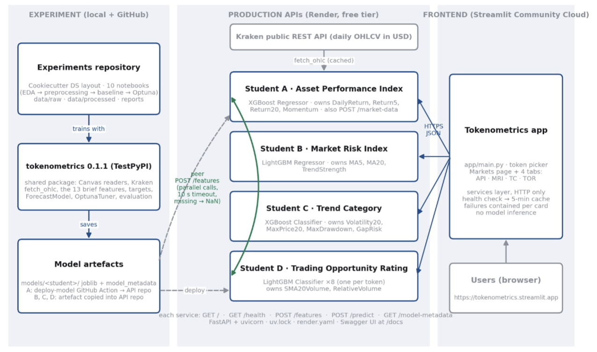
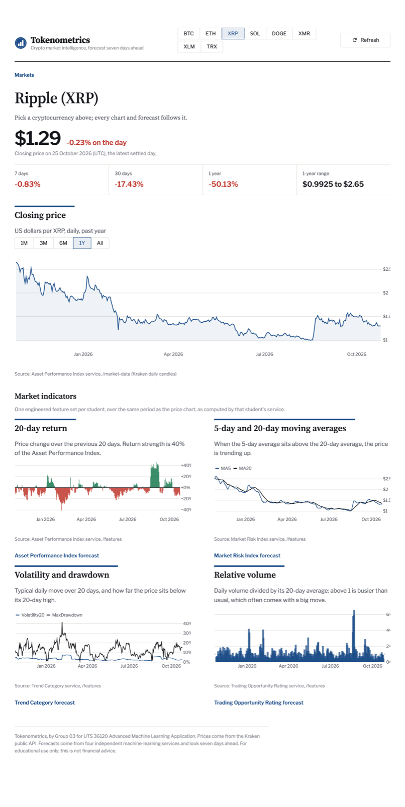
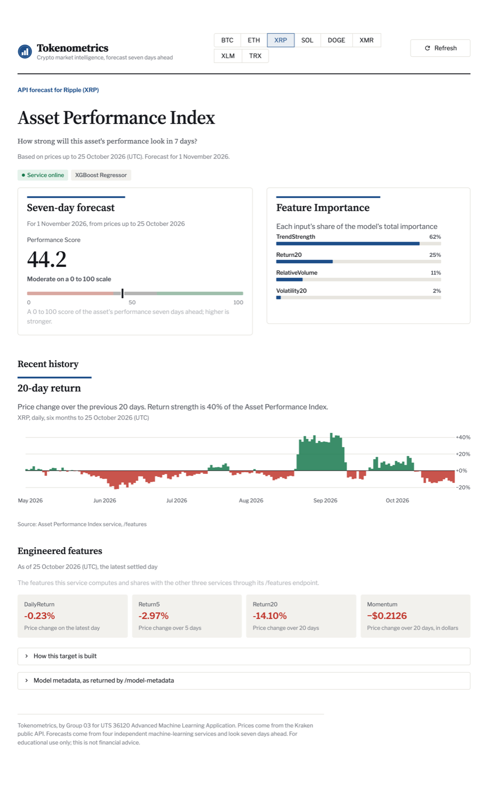
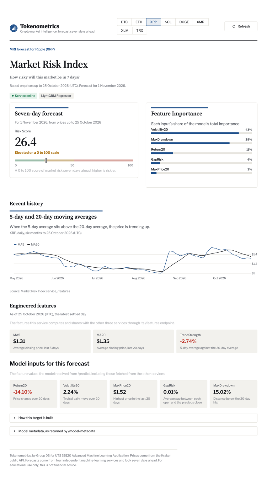
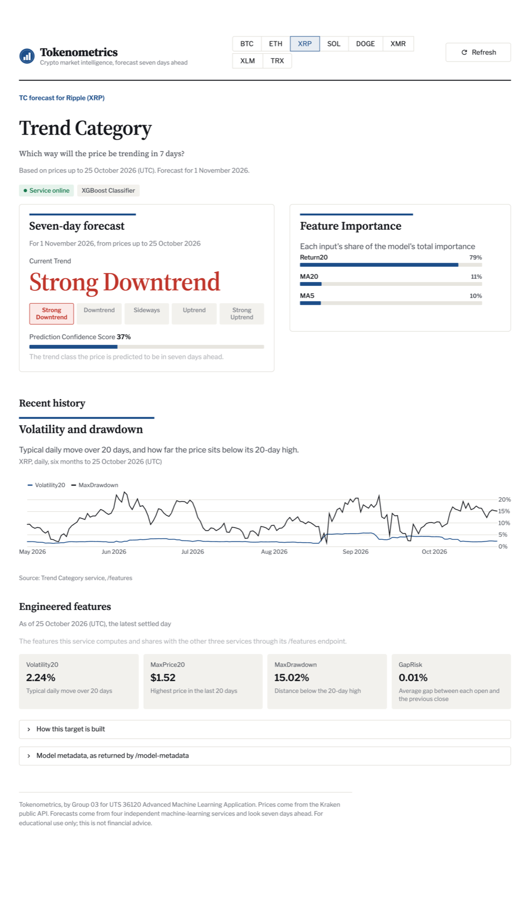
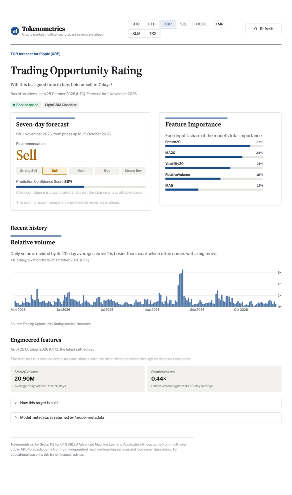

# Tokenometrics

A machine learning data product that forecasts four market indicators for
eight cryptocurrencies, **7 days ahead**. Built by Group 03 for 36120 Advanced
Machine Learning Applications at UTS.

Each model has its own FastAPI service, and the services share engineered
features with each other at prediction time. A Streamlit app brings the four
forecasts together for one token at a time.

**Tokens:** BTC, ETH, XRP, SOL, DOGE, XMR, XLM, TRX (focus token: **XRP**)

## Architecture

- **Training data:** historical daily open, high, low, close, volume and market
  cap for each token. Models are trained on this data only.
- **Live data:** Kraken's public daily candles, used only to compute today's
  features when a prediction is requested.
- **Shared code:** a small internal Python package holds the data access and
  feature formulas, so the notebooks and all four services compute features
  the same way.

## The app

Pick a token at the top and every chart and forecast follows it. Shown here
for XRP.

### Markets

The latest price, 7-day, 30-day and 1-year change, a price chart, and one
engineered-feature chart from each service.

### Asset Performance Index

A 0–100 performance score for 7 days ahead, the model's feature importance,
the 20-day return history and the features this service owns.

### Market Risk Index

A 0–100 risk score for 7 days ahead, feature importance, the moving-average
history, and every input the model received, including those fetched from
the other services.

### Trend Category

The predicted trend class with its confidence, feature importance, and the
volatility and drawdown history.

### Trading Opportunity Rating

A Strong Sell to Strong Buy recommendation with its confidence, feature
importance, and the relative volume history.

## Projects

| Project | What it holds |
|---|---|
| Experiments | A Cookiecutter Data Science project with exploration, feature engineering, baselines, Optuna tuning and the final model files for all four targets |
| Four API services | One FastAPI service per target, each deployed separately |
| Streamlit app | The shared frontend: a market overview plus one page per target |
| Shared package | Data access and feature formulas used by everything above |

## Features

Each service owns a set of engineered features and serves them on
`POST /features`. A service asks its peers for the features it doesn't own.

| Owner | Features |
|---|---|
| Asset Performance service | Daily return, 5-day return, 20-day return, 20-day momentum |
| Market Risk service | 5-day and 20-day moving averages, trend strength (MA5 / MA20 − 1) |
| Trend Category service | 20-day volatility of daily returns, 20-day maximum price, maximum drawdown, gap risk |
| Trading Opportunity service | 20-day volume moving average, relative volume |

## Models

| Target | Type | Algorithm | Inputs | Output |
|---|---|---|---|---|
| Asset Performance Index | Regression | XGBoost | 20-day return, trend strength, relative volume, volatility | Score from 0 to 100 combining return strength, trend, volume and price stability |
| Market Risk Index | Regression | LightGBM | 20-day return, volatility, 20-day maximum price, gap risk, drawdown | Score from 0 to 100 combining volatility, drawdown, downside return and gap risk |
| Trend Category | Multiclass | XGBoost | MA5, MA20, 20-day return | Strong Downtrend, Downtrend, Sideways, Uptrend or Strong Uptrend, with confidence |
| Trading Opportunity Rating | Multiclass | LightGBM | 20-day return, relative volume, volatility, MA5, MA20 | Strong Sell, Sell, Hold, Buy or Strong Buy, with confidence |

Three models are pooled across all eight tokens. The Trading Opportunity
Rating uses one model per token.

## Modelling approach

- **Genuine forecasting:** every target is the value 7 days after the
  prediction date, and features use only information available up to that
  date.
- **Chronological splits:** train, validation and test sets are split by
  calendar date, never shuffled, with a 7-day embargo or purge at each
  boundary so no target overlaps the next period.
- **Gaps in history:** where a token's history has a gap, rolling windows and
  targets are computed within each continuous stretch of days, so a gap is
  never treated as consecutive days.
- **Baselines first:** each model is compared with a simple baseline (mean,
  persistence, majority class or class prior) before tuning.
- **Optuna tuning:** XGBoost and LightGBM hyperparameters are tuned with Optuna
  using time-series cross-validation or a time-ordered validation set. Search
  spaces and best parameters are saved with each model.
- **Built for missing inputs:** XGBoost and LightGBM handle missing values
  natively, and the regression models are also trained with copies of the
  data where a peer's features are missing. If a peer service is down at
  prediction time, its features are sent as missing values, a prediction is
  still returned, and the response lists what was missing.

## Service contract

Every service exposes the same endpoints:

| Method | Endpoint | Purpose |
|---|---|---|
| GET | `/` | Overview of the service and its endpoints |
| GET | `/health` | Health check |
| GET | `/model-metadata` | Target, algorithm, horizon, features and feature importance |
| POST | `/features` | The engineered features this service owns |
| POST | `/predict` | 7-day forecast for a token, plus confidence for the classifiers |

Requests look like `{"token": "XRP", "forecast_horizon": 7}`. Errors return
JSON with a clear message, for example for an unsupported token or an invalid
horizon.

## Working agreement

Changes reach `main` through pull requests reviewed by another member.
